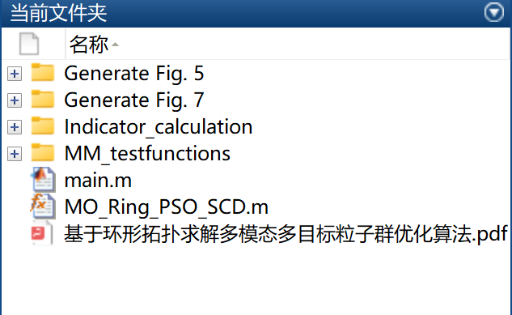
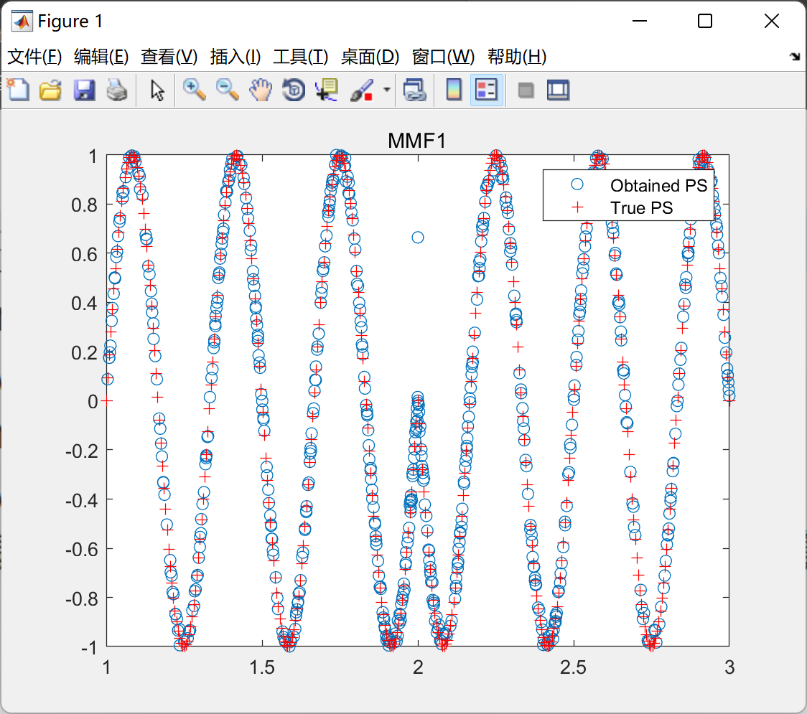
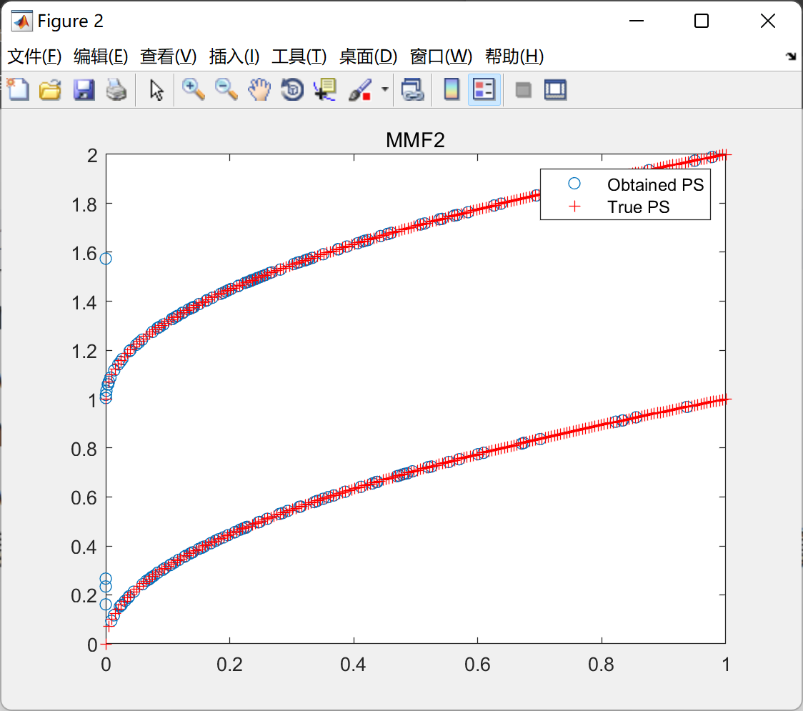
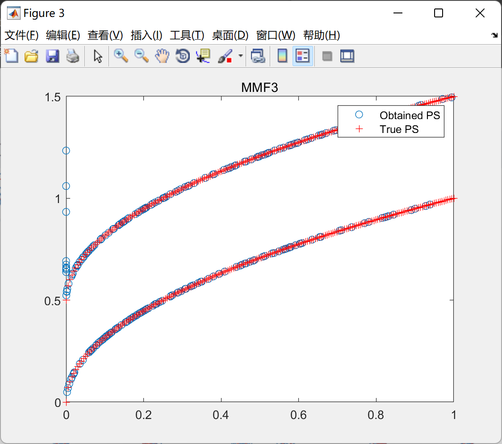
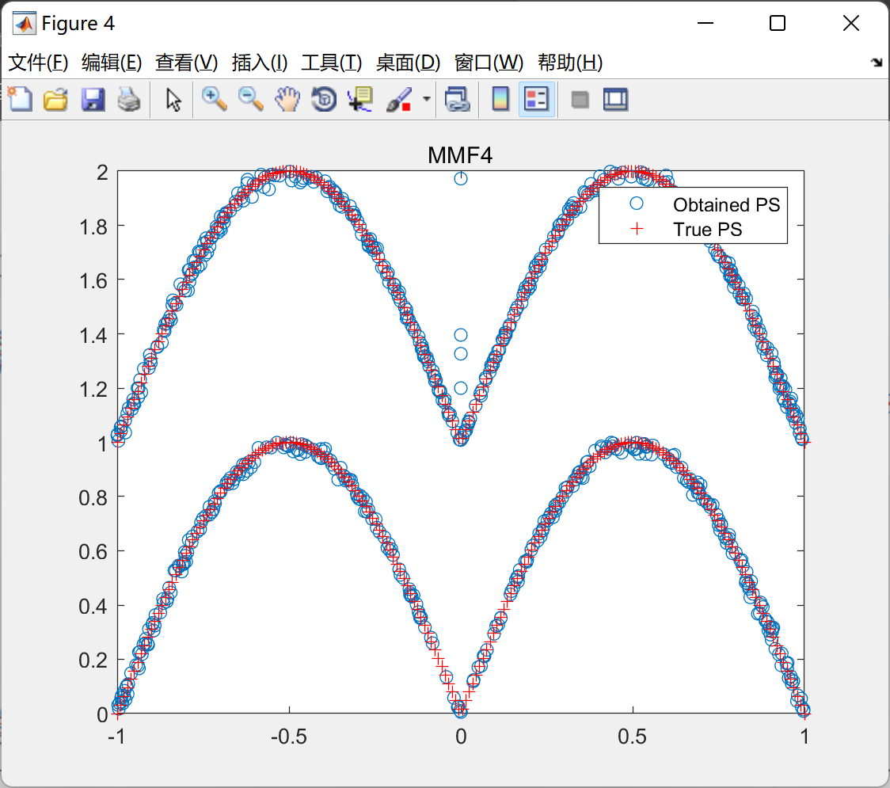
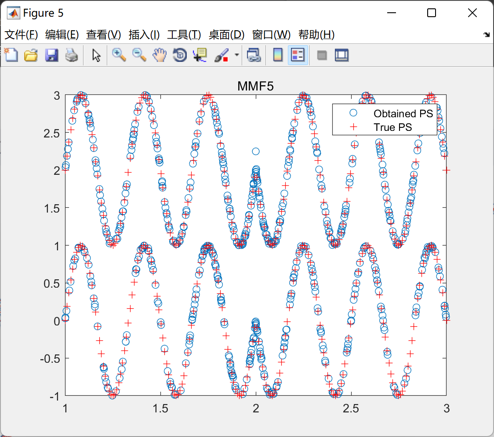

# Particle Swarm Optimization Algorithm Based on Ring Topology for Multimodal and Multi-Objective Problems (Matlab Code)

Particle Swarm Optimization Algorithm with Multimodality and Multi-Objectives Based on Cyclic Topology (Matlab Code)

## Images

<!-- PAYMENT_BLOCK -->

## Get this dataset

- Payment link (Stripe): [Buy now](https://buy.stripe.com/3cs8yP7sY87d0vu9AB)
- Payment QR code: 

<!-- /PAYMENT_BLOCK -->
